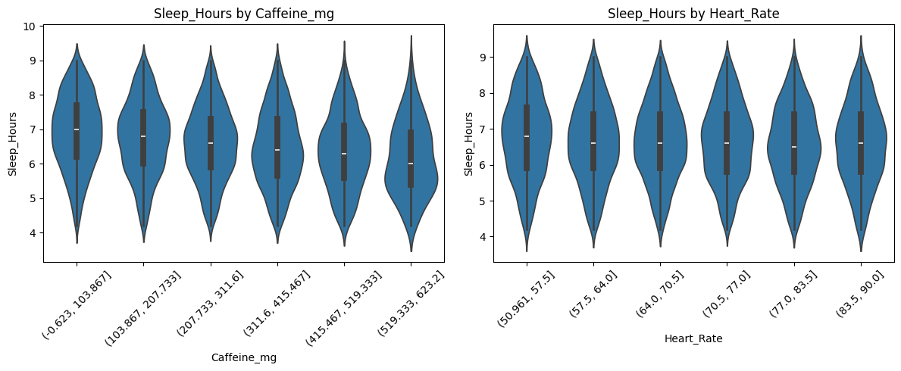

# Влияние потребления кофе на показатели сна и здоровья

**Учебный проект по анализу данных на Python:** исследовательский анализ (EDA), визуализация, проверка статистических гипотез и построение модели линейной регрессии.

## О проекте

Цель — исследовать, как потребление кофеина и другие характеристики респондентов связаны с продолжительностью сна, а также построить модель прогнозирования показателя `Sleep_Hours`.

**Источник:** [Global Coffee & Health Dataset (Kaggle)](https://www.kaggle.com/datasets/uom190346a/global-coffee-health-dataset).

**Важно:** датасет **синтетический**. Выявленные зависимости характеризуют исследуемые данные и **не доказывают причинно-следственного влияния** кофеина на сон или здоровье человека.

## Данные

- **10 000 наблюдений**, **16 исходных признаков**; одна строка соответствует одному респонденту.
- Переменные охватывают возраст, пол, страну, потребление кофе и кофеина, продолжительность и качество сна, индекс массы тела, пульс, уровень стресса, физическую активность, занятость и некоторые привычки.
- Целевая переменная для регрессии — **`Sleep_Hours`** (продолжительность сна в часах).
- В столбце `Health_Issues` обнаружено **5 941 пропущенное значение (59,41%)**, поэтому в ходе анализа столбец исключён.
- После последовательной фильтрации выбросов по правилу ±2 стандартных отклонения и методу 1,5 × IQR осталось **8 634 наблюдения**.

## Ход исследования

1. **Знакомство с данными:** структура, типы признаков, пропуски и дубликаты.
2. **Подготовка:** удаление столбца с большим числом пропусков, проверка дубликатов, исключение `Coffee_Intake` из дальнейших расчётов в пользу `Caffeine_mg`, обработка выбросов.
3. **EDA:** гистограммы, столбчатые диаграммы, boxplot и violinplot, описательные статистики.
4. **Корреляционный анализ:** корреляции Пирсона и Спирмана, визуализация связей с `Sleep_Hours`.
5. **Регрессия:** кодирование категориальных признаков, разделение данных на обучающую и тестовую выборки (80/20), стандартизация и обучение `LinearRegression`.
6. **Проверка гипотез:** одновыборочный t-тест, тест Манна — Уитни, z-тесты пропорций и критерий χ².

## Основные результаты

| Показатель | Результат |
|---|---:|
| Средняя продолжительность сна после очистки | **6,63 часа** |
| Корреляция Пирсона между потреблением кофеина и продолжительностью сна | **−0,18** |
| Коэффициент детерминации линейной регрессии на тестовой выборке, R² | **0,823** |
| Средняя абсолютная ошибка на тестовой выборке, MAE | **0,365 часа** |
| Среднеквадратичная ошибка на тестовой выборке, MSE | **0,204 часа²** |

- В синтетической выборке наблюдается **слабая отрицательная корреляция** между количеством кофеина и продолжительностью сна.
- Тест Манна — Уитни обнаруживает статистически значимое различие продолжительности сна у потребителей и непотребителей кофеина (**p ≈ 2,37 × 10⁻⁷**).
- Критерий χ² не выявляет статистически значимой связи между типом занятости и оценкой качества сна при уровне значимости 5% (**p ≈ 0,265**).

### Пример визуализации

Распределение продолжительности сна в группах по потреблению кофеина и частоте сердечных сокращений:



## Модель

Для прогнозирования `Sleep_Hours` использована **множественная линейная регрессия** (`scikit-learn`) с пятью признаками:

- `Stress_Level_encoded` — закодированный уровень стресса;
- `Sleep_Quality_encoded` — закодированная оценка качества сна;
- `Caffeine_mg` — потребление кофеина в мг;
- `Heart_Rate` — частота пульса;
- `Smoking_True` — бинарный индикатор курения.

Оценка качества выполнена на отложенной тестовой выборке (20%). Метрики отражают качество модели **только в рамках этого синтетического датасета**. Признак `Sleep_Quality` тесно связан с целевой переменной, поэтому высокий R² нельзя интерпретировать как доказательство универсальной предсказательной способности модели на реальных данных.

## Стек

`Python` · `pandas` · `NumPy` · `Matplotlib` · `Seaborn` · `SciPy` · `scikit-learn` · `statsmodels` · `Jupyter Notebook`

## Структура репозитория

```text
coffee-sleep-health-analysis/
├── README.md
├── analysis.ipynb
├── synthetic_coffee_health_10000.csv
├── requirements.txt
├── .gitignore
└── images/
    └── sleep_vs_caffeine_and_heart_rate.png
```

## Как запустить

1. Скачайте или клонируйте репозиторий.
2. Установите зависимости:

   ```bash
   python -m pip install -r requirements.txt
   ```

3. Откройте `analysis.ipynb` в Jupyter Notebook или Google Colab.
4. Запустите ячейки **сверху вниз**. CSV-файл должен находиться в той же папке, что и ноутбук, поскольку код использует относительный путь `synthetic_coffee_health_10000.csv`.

При запуске в Google Colab отдельно загрузите CSV-файл в текущую рабочую директорию среды (либо подключите Google Drive и скорректируйте путь).

## Ограничения

- Используются искусственно сгенерированные данные; результаты нельзя переносить на реальные медицинские исследования без дополнительной проверки.
- Анализ описывает статистические взаимосвязи, **не причинно-следственные эффекты**.
- Предобработка выбросов проводится до train/test-разделения; для применения модели в реальном проекте следует оформить воспроизводимый пайплайн с обработкой обучающей и тестовой выборок отдельно.
- Для публичной публикации исходного CSV следует проверить лицензию и условия использования датасета на Kaggle.

---

**Автор:** Марианна Гаургашвили · Учебный проект по анализу данных
